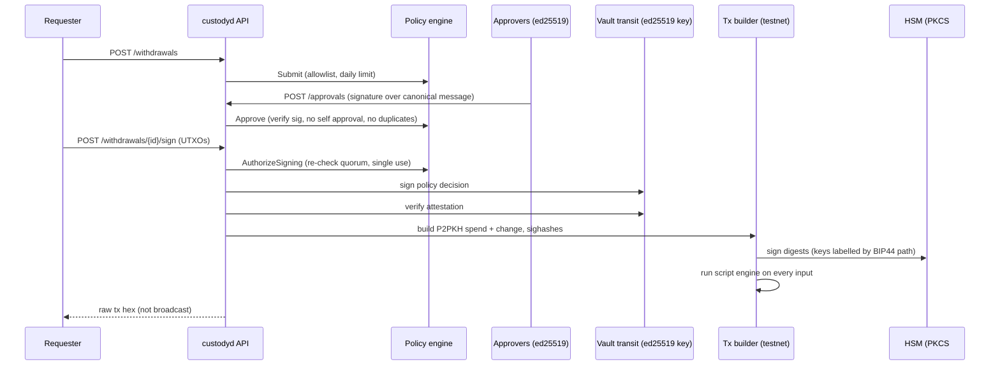

# crypto-custody-signer

A Go custody signer demo: a **BIP32/39/44 HD wallet**, a **multi approval policy engine** (m of n, role requirements, limits, expiry), **policy attestations signed by HashiCorp Vault transit**, transaction keys held in a **PKCS#11 HSM (SoftHSM2)**, and **testnet only** Bitcoin transaction building that is checked by the btcd script engine before it is returned.

> Portfolio demo. Testnet only, mainnet is refused in code. Nothing is broadcast. Not audited and not used with real funds.

## Problem

Custody systems separate *who decides* a withdrawal can happen from *what holds the key*:

- No single person should be able to move funds: approvals must come from distinct, authenticated people, with more approvals (and a risk officer) for larger amounts.
- The signing key should live in an HSM, and the HSM should only be asked to sign after the policy decision is verified.
- Mistakes must fail safe: wrong network, replayed approvals, double signing, stale approvals.

## Architecture



## Components

| Package | What it does |
|---|---|
| `internal/hdwallet` | BIP39 mnemonic and seed, BIP32 derivation, BIP44 paths `m/44'/1'/account'/change/index`, account xpub export, mainnet refused |
| `internal/policy` | Tiers by amount (approvals + required roles), destination allowlist, rolling 24h limit, approval TTL, request TTL, veto, single use signing authorization, thread safe |
| `internal/attest` | Policy decision attestations through Vault transit (`/keys`, `/sign`, `/verify`) with an in process fallback |
| `internal/signer` | `Backend` interface; in memory HSM and a PKCS#11 backend (build tag `pkcs11`) that imports or generates secp256k1 keys as non extractable token objects and normalises signatures to low S DER |
| `internal/txbuilder` | Testnet P2PKH spend, fee estimate, change with dust check, rejects mainnet destinations, verifies signatures with `txscript.NewEngine` |
| `internal/api` | HTTP endpoints tying it together |

## Run it

```bash
go run ./cmd/custodyd                       # in memory backends, random testnet wallet
docker compose up --build                   # with a Vault dev server for attestations
```

Endpoints: `GET /addresses/{index}`, `POST /withdrawals`, `GET /withdrawals/{id}`, `GET /withdrawals/{id}/message` (the bytes approvers sign), `POST /withdrawals/{id}/approvals`, `POST /withdrawals/{id}/sign`.

Approvers are configured with `APPROVERS_JSON='[{"id":"alice","roles":["ops"],"public_key_hex":"..."}]'`.

## Tests

```bash
go test -race ./...

# HSM and Vault integration (what CI runs)
eval "$(./scripts/softhsm-init.sh)"
VAULT_ADDR=http://127.0.0.1:8200 VAULT_TOKEN=root go test -tags pkcs11 ./internal/signer/ ./internal/attest/
```

- **Standard vectors:** BIP39 (Trezor vector, passphrase "TREZOR"), BIP32 test vector 1, and the well known BIP44 addresses for the "abandon ... about" mnemonic on mainnet (derivation check only) and testnet.
- **Policy:** quorum by tier, risk role requirement, self approval, duplicate approval, forged and replayed signatures, stale approvals, request expiry, daily limit, allowlist, veto, and 50 concurrent sign attempts producing exactly one authorization.
- **HSM contract:** the same test suite runs against the in memory backend and a real SoftHSM2 token (imported and token generated keys).
- **Vault:** an httptest fake plus a real Vault dev server in CI.
- **End to end:** submit, approve twice, sign, verify the raw transaction, and refuse a second signing.

## Design decisions

- **Approvals sign a canonical, domain separated message** binding id, asset, amount and destination, so a signature cannot be replayed on another withdrawal.
- **Policy is checked twice**: when the last approval lands and again at signing time, where authorization is single use under a lock.
- **Vault signs the decision, the HSM signs the transaction.** Vault transit does not offer secp256k1, so it is used for what it does support (ed25519 attestations), and Bitcoin keys live in a PKCS#11 token. Compromising the API process alone is not enough to get an attestation without Vault.
- **Keys labelled by derivation path** in the HSM, so the builder never handles private keys.
- **Script engine check before returning** a transaction catches any signing or script mistake locally.
- **Testnet only by construction**: the wallet and builder reject mainnet parameters and mainnet destination addresses.

## Limitations

- Keys are derived in process and then imported into the HSM. A real deployment would generate keys inside the HSM (supported by `GenerateKey`) or use an HSM that supports BIP32 derivation.
- P2PKH only (no SegWit/Taproot), simple fee estimate, UTXOs supplied by the caller, no broadcast.
- In memory state; no persistence, audit log store or approver key rotation.
- Not reviewed by a security auditor.

## License

MIT
